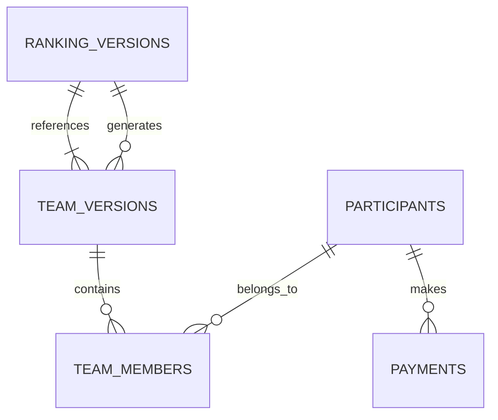

# Project 01 — Database Design

**Confidence:** VERIFIED (`backend/app/models/models.py`)

## Entity Relationship Diagram

## Table Descriptions

| Table | Primary Key | Key Fields | Description |
|-------|------------|------------|-------------|
| `participants` | `id` (String UUID) | email, current_rank, current_stars, highest_rank, highest_stars, primary_lane, secondary_lane, primary_lane_comfort, secondary_lane_comfort, skill_score, role_flexibility_score, status, rank, lane_capabilities (JSON) | Participant records with computed skill and flexibility scores |
| `ranking_versions` | `id` (String UUID) | generated_at, confirmed_at, status, total_participants, qualified_count, eliminated_count, generated_by, seed, score_components (JSON), is_active | Versioned ranking snapshots |
| `team_versions` | `id` (String UUID) | ranking_version_id (FK), generated_at, confirmed_at, status, total_teams, total_participants, selected_count, not_selected_count, overall_fairness, random_seed, optimization_iterations, processing_time_ms, generated_by, is_active | Versioned team generation results |
| `team_members` | `id` (String UUID) | team_version_id (FK), team_id, player_id (FK), assigned_lane, comfort_in_assigned_lane, role_compatibility_score, assignment_reason, average_skill_score, role_balance_score, overall_fairness, fairness_breakdown (JSON) | Individual player assignments within a team version |
| `payments` | `id` (String UUID) | player_id (FK), status (PENDING/PAID/FAILED), amount, method, paid_at, verified_by, verified_at, transaction_id, notes | Payment records for team access |
| `system_state` | `id` (String UUID) | state (DRAFT/RANKING_GENERATED/TEAM_GENERATED/PAYMENT_OPEN/COMPETITION_READY), current_ranking_version_id, current_team_version_id, updated_at | Singleton workflow state |
| `audit_logs` | `id` (String UUID) | action, actor, timestamp, log_metadata (JSON) | Append-only admin action log |

## Constraints

- `participants.email` — indexed, nullable
- `participants.status` — indexed, default "REGISTERED"
- `participants.rank` — indexed, nullable
- `participants.lane_capabilities` — stored as JSON string
- `team_members.fairness_breakdown` — stored as JSON string
- No explicit foreign key constraints in SQLAlchemy models (application-level enforcement)
