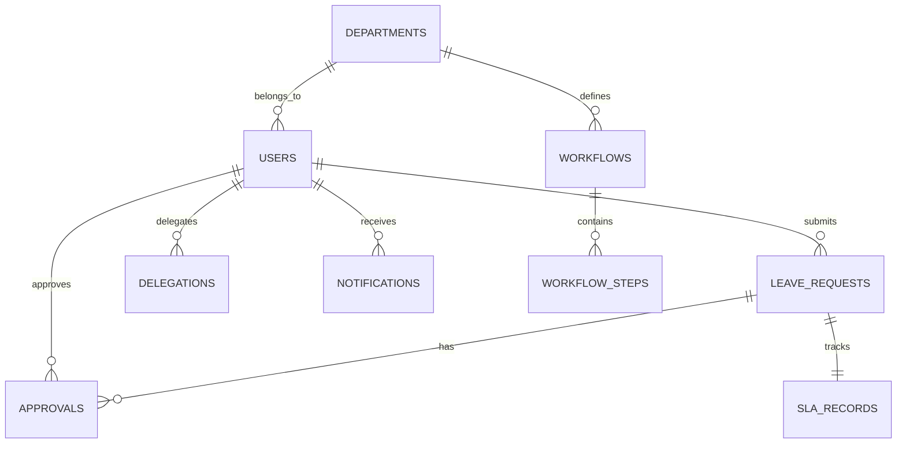

# Project 02 — LeaveSphere (Integrated HR Leave Management System)

**Repository:** `/Users/user/LeaveSphere/` (web) + `/Users/user/LeaveSphere-Mobile/` (Flutter)
**Confidence:** VERIFIED

## Executive Summary

LeaveSphere is an integrated HR leave-management solution consisting of a Laravel 12 web administration panel and a Flutter mobile application for employees. The web panel handles admin/manager approval workflows, while the mobile app handles employee self-service (leave submission, history, calendar, profile). Both communicate via REST API with Laravel Sanctum token authentication.

**Period:** March 2026 – June 2026
**Organization:** Telkom University (Kelompok 7)
**Location:** Bandung, Indonesia

## Technology Stack (VERIFIED)

| Layer | Technology | Evidence |
|-------|-----------|----------|
| Web Backend | PHP, Laravel 12 | `composer.json` (`laravel/framework: ^12.0`) |
| Web Frontend | Blade + Tailwind CSS (CDN) + Alpine.js (CDN) | `resources/views/`, README |
| Mobile | Flutter, Dart | `pubspec.yaml`, `lib/` |
| API | REST + Laravel Sanctum | `routes/api.php`, `composer.json` (`laravel/sanctum: ^4.3`) |
| Database | MySQL / SQLite | `.env.example`, migrations |
| Auth | Laravel Sanctum | `User` model uses `HasApiTokens` |
| Charts | Chart.js (CDN) | README |
| Calendar | FullCalendar (CDN) | README |

## Business Requirements (VERIFIED from README + source)

### Functional Requirements

| ID | Requirement | Evidence |
|----|-----------|----------|
| FR-01 | Leave submission (employee) | `POST /api/leave-requests`, `LeaveRequestController::store()` |
| FR-02 | Leave approval/reject (manager) | `POST /approvals/{id}/approve`, `ApprovalController` |
| FR-03 | Role-Based Access Control | `User::ROLE_SUPER_ADMIN/MANAGER/EMPLOYEE`, `CheckRole` middleware |
| FR-04 | HR dashboards | `DashboardController`, stats cards, pending approvals |
| FR-05 | Team calendar | `CalendarController`, FullCalendar |
| FR-06 | Delegation management | `DelegationController`, `Delegation` model |
| FR-07 | Analytics & insights | `AnalyticsController`, Chart.js |
| FR-08 | REST API for mobile | `routes/api.php`, Sanctum middleware |
| FR-09 | Laravel Sanctum auth | `routes/api.php` → `auth:sanctum` |
| FR-10 | Leave balance calculation | `User.leave_balance`, checked in `store()` |
| FR-11 | SLA monitoring | `SlaRecord`, `SlaController` |
| FR-12 | AI-assisted leave-spike prediction | DESIGN only (README: "UI statis, perlu logic backend") |
| FR-13 | Conflict detection | DESIGN only |
| FR-14 | Workforce risk analysis | DESIGN only |

### Non-Functional Requirements

- Responsive web UI (dark sidebar, light content)
- Mobile app for Android (emulator via 10.0.2.2, physical device via IP)
- Token-based API auth (Sanctum)
- 25-day max leave per request (validated in controller)

## Database Schema (VERIFIED from migrations)

| Table | Key Fields |
|-------|-----------|
| `users` | id, employee_id, name, email, password, department_id, role (super_admin/manager/employee), leave_balance, status |
| `departments` | id, name, code |
| `leave_requests` | id, user_id, leave_type, start_date, end_date, total_days, reason, status (pending/approved/rejected) |
| `approvals` | id, leave_request_id, approver_id, status, notes |
| `delegations` | id, delegator_id, delegate_id, permissions, status |
| `workflows` | id, department_id, name |
| `workflow_steps` | id, workflow_id, step_order, role, action |
| `sla_records` | id, leave_request_id, deadline, breached |
| `notifications` | id, user_id, type, message, is_read |
| `personal_access_tokens` | id, tokenable_type, tokenable_id, name, token, abilities, last_used_at, expires_at (Sanctum) |

## API Endpoints (VERIFIED from `routes/api.php`)

| Method | Endpoint | Auth | Purpose |
|--------|----------|------|---------|
| POST | `/api/login` | None | Employee login, returns Sanctum token |
| POST | `/api/logout` | Sanctum | Logout (revoke token) |
| GET | `/api/me` | Sanctum | Current user profile |
| GET | `/api/home` | Sanctum | Home dashboard (leave balance, summary) |
| GET | `/api/leave-requests` | Sanctum | List employee's leave requests |
| POST | `/api/leave-requests` | Sanctum | Submit new leave request |
| GET | `/api/leave-requests/{id}` | Sanctum | Get leave request detail |
| DELETE | `/api/leave-requests/{id}` | Sanctum | Cancel pending leave request |
| GET | `/api/calendar` | Sanctum | Team calendar events |
| GET | `/api/profile` | Sanctum | Profile info |
| PUT | `/api/profile/password` | Sanctum | Change password |

### Web Routes (VERIFIED from `routes/web.php`)

Dashboard, approvals (approve/reject), recommendations, calendar, delegation, SLA, analytics, workflows, users (CRUD), settings, notifications.

## Mobile Architecture (VERIFIED from `lib/`)

| File | Purpose |
|------|---------|
| `lib/main.dart` | Entry point |
| `lib/services/api_service.dart` | HTTP client + token storage (SharedPreferences), baseUrl `http://192.168.18.170:8000/api` |
| `lib/services/auth_service.dart` | Login/logout |
| `lib/services/leave_service.dart` | Apply/history/cancel leave |
| `lib/services/home_service.dart` | Home dashboard summary |
| `lib/services/calendar_service.dart` | Team calendar events |
| `lib/services/profile_service.dart` | Profile + change password |
| `lib/models/user_model.dart` | User data model |
| `lib/models/leave_request_model.dart` | Leave request data model |
| `lib/models/calendar_event_model.dart` | Calendar event data model |
| `lib/screens/` | 6 screens (Login, Home, Apply Leave, History, Calendar, Profile) |
| `lib/utils/app_theme.dart` | Centralized theme (matches web admin) |

## AI Features Status (VERIFIED from README)

**NOT implemented — designed/conceptual only:**
- Leave-spike prediction (UI static, needs backend logic)
- Conflict detection (designed only)
- Workforce risk analysis (designed only)

README explicitly states: *"AI Smart Recommendations engine — saat ini UI statis, perlu logic backend (analisis pattern dari leave_requests table)."*

## Personal Contribution (VERIFIED from README team table)

| Role | Name | NIM |
|------|------|-----|
| Backend Dev | Alifito Rabbani C. | 103012300477 |
| Frontend Web Dev | Alifito Rabbani C. | 103012300477 |
| Mobile Developer | Alifito Rabbani C. | 103012300477 |
| AI Engineer | Alifito Rabbani C. | 103012300477 |

Alifito personally contributed to backend, frontend web, mobile, and AI engineering roles. This is a **group project (Kelompok 7)** — not all features are individually attributable.

## Security Analysis (VERIFIED)

- **Authentication:** Laravel Sanctum token auth for API; session-based auth for web
- **Authorization:** Role-based (super_admin, manager, employee) via `CheckRole` middleware
- **Password:** Hashed via Laravel's `Hash::check()`
- **Token management:** Token revocation on logout (`$user->tokens()->delete()`)
- **Input validation:** Laravel form validation in controllers
- **SQL injection:** Protected by Eloquent ORM (parameterized queries)
- **Rate limiting:** Not implemented in API routes
- **CORS:** Not explicitly configured for API

## Testing Evidence

- PHPUnit configured (`composer.json` dev dependency)
- Database seeders create 150 dummy users, leave requests, approvals, delegations
- No test files found in repository (NOT VERIFIED — tests not present)

## Interview Preparation — Key Points

1. **Sanctum auth flow:** How tokens are created, stored on mobile (SharedPreferences), sent as Bearer header
2. **Leave balance check:** Validated in `LeaveRequestController::store()` — checks `$user->leave_balance` before creating request
3. **Max 25 days:** Hard limit enforced in controller
4. **Role model:** 3 roles (super_admin, manager, employee) with `isSuperAdmin()`, `isManager()`, `isEmployee()` methods
5. **Mobile-web communication:** Flutter mobile calls Laravel API via Sanctum token; baseUrl configurable per environment
6. **AI features:** Explicitly NOT implemented — only UI designed; important to not overclaim
7. **SLA:** 24-hour deadline (`now()->addHours(24)`) tracked in `SlaRecord`
