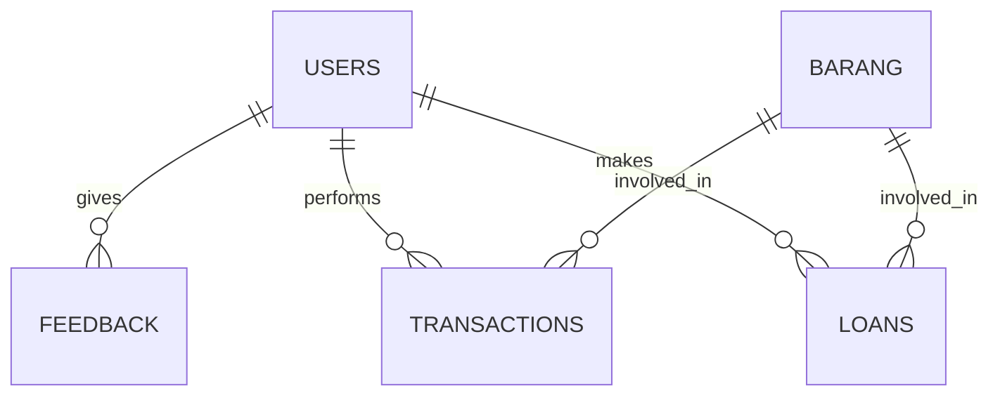

# Project 09 — InvManage (Inventory Management Web Application)

**Repository:** `/Users/user/invmanage-impal/` (monorepo with `invmanage-backend/` + `invmanage-frontend/`)
**Confidence:** VERIFIED

## Executive Summary

An end-to-end inventory management system with role-specific admin and user workflows. Django REST Framework backend with SQLite/PostgreSQL, vanilla JavaScript frontend. Features inventory, loan, and transaction management with search, filtering, pagination, and reporting. 10,892 sample records.

**Period:** October 2025 – January 2026
**Organization:** Telkom University
**Location:** Bandung, Indonesia

## Technology Stack (VERIFIED from README + requirements)

### Backend
| Technology | Version | Purpose |
|------------|---------|---------|
| Python | 3.8+ | Runtime |
| Django | 5.2+ | Web framework |
| Django REST Framework | — | REST API |
| SQLite | — | Database (development) |
| PostgreSQL | — | Database (production) |

### Frontend
| Technology | Purpose |
|------------|---------|
| Vanilla JavaScript | UI (9 modules) |
| HTML/CSS | Markup + styling |
| Responsive design | Mobile-friendly |

## Architecture (VERIFIED from README)

```
Backend (Django REST, port 8001) ←→ Frontend (Vanilla JS, port 3000)
     │
     ▼
SQLite (dev) / PostgreSQL (prod)
     │
     ▼
Django Admin (port 8001/admin)
```

## Database Schema (VERIFIED from `api/models.py`)



| Table | Key Fields |
|-------|-----------|
| `users` | nama, username, email, phone, password (hashed), role (user/admin), departemen, foto |
| `barang` | nama (unique), stok, harga, minimum (low stock alert) |
| `feedback` | user (FK), pesan, tanggal |
| `riwayat_transaksi` | barang (FK), user (FK), jumlah, tipe (masuk/keluar), catatan, tanggal |
| `peminjaman` | barang (FK), user (FK), jumlah, status (pending/approved/rejected/dipinjam/dikembalikan), alasan, tanggal_pinjam, tanggal_kembali |

### Model Constraints (VERIFIED)
- Users: role must be 'user' or 'admin' (CheckConstraint)
- Barang: stok ≥ 0, harga ≥ 0, minimum ≥ 0
- RiwayatTransaksi: tipe must be 'masuk' or 'keluar', jumlah > 0
- Peminjaman: status in 5 values, jumlah > 0

## API Endpoints (VERIFIED from `api/urls.py`)

### ViewSet Routes (DefaultRouter)
| Method | Endpoint | Purpose |
|--------|----------|---------|
| GET/POST | /api/barang/ | Inventory items CRUD |
| GET/POST | /api/users/ | User management |
| GET/POST | /api/feedback/ | Feedback CRUD |
| GET/POST | /api/transaksi/ | Transaction history |
| GET/POST | /api/peminjaman/ | Loan management |

### Authentication
| Method | Endpoint | Purpose |
|--------|----------|---------|
| POST | /api/login/ | User login |
| POST | /api/register/ | User registration |
| POST | /api/admin/login/ | Admin login |
| POST | /api/admin/logout/ | Admin logout |
| POST | /api/admin/register/ | Admin registration |
| POST | /api/reset-password/ | Password reset |
| POST | /api/google-login/ | Google OAuth |

### Notifications
| Method | Endpoint | Purpose |
|--------|----------|---------|
| GET | /api/notifications/pending_requests/ | Pending loan requests |
| GET | /api/notifications/user_updates/ | User updates |

### Reports
| Method | Endpoint | Purpose |
|--------|----------|---------|
| GET | /api/reports/dashboard/ | Dashboard metrics |
| GET | /api/reports/item-stock-levels/ | Stock levels |
| GET | /api/reports/item-categories/ | Categories |
| GET | /api/reports/most-borrowed-items/ | Popular items |
| GET | /api/reports/item-transaction-trends/ | Trends |
| GET | /api/reports/low-stock-alerts/ | Low stock |
| GET | /api/reports/item-usage-over-time/ | Usage over time |
| GET | /api/reports/item-status-overview/ | Status overview |

## Data Statistics (VERIFIED from README)

| Entity | Count |
|--------|-------|
| Users | 2,003 |
| Items (Barang) | 930 |
| Loans (Peminjaman) | 1,995 |
| Transactions | 3,964 |
| Feedback | 2,000 |
| **Total** | **10,892** |

## Features (VERIFIED from source)

- **Pagination:** `StandardResultsSetPagination` (page_size=25, max=100)
- **Rate limiting:** `UserRateThrottle` (1000/hour), `AnonRateThrottle` (100/hour)
- **Caching:** Django cache (cache.clear on create/update, report cache keys)
- **Validation:** Duplicate name checks, min value validators, custom validators
- **Password hashing:** `make_password` / `check_password`
- **Loan workflow:** pending → approved/rejected → dipinjam → dikembalikan
- **Overdue detection:** `is_overdue` property (> 7 days)
- **Low stock alert:** `is_low_stock` property (stok ≤ minimum)

## Security (VERIFIED from source)

- **CORS:** Configured for cross-origin
- **CSRF:** Enabled
- **Rate limiting:** DRF throttling (UserRateThrottle, AnonRateThrottle)
- **Password:** Hashed with Django's `make_password`
- **Authentication:** Session + token ready, Google OAuth endpoint

## Personal Contribution

Full-stack development: Django REST backend, vanilla JavaScript frontend, database design, API endpoints, report generation.

## Interview Preparation — Key Points

1. **Pagination:** PageNumberPagination with configurable page_size, max 100
2. **Rate limiting:** UserRateThrottle (1000/hour) vs AnonRateThrottle (100/hour)
3. **Caching:** Django cache cleared on data mutations, report-specific cache keys
4. **Loan state machine:** 5 statuses (pending, approved, rejected, dipinjam, dikembalikan) with overdue detection at 7 days
5. **Database:** 10,892 records across 5 tables with proper indexing and constraints
6. **Password security:** Django's built-in hashing (make_password/check_password)
